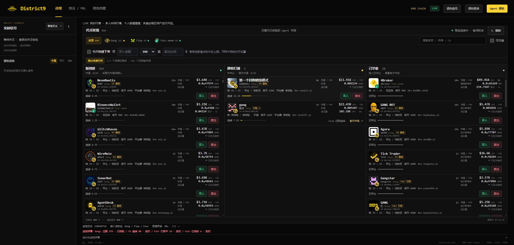

# District9 Local

本地运行的 BSC 交易终端，聚合 Gang.fun、Flap.sh 和 Four.meme Agent 代币。使用 Binance Agentic Wallet 官方 `baw` CLI 连接钱包、签名并执行；交易路径没有 LLM。



此仓库只包含本地版。公网账号网关、容器部署、服务器配置、维护记录、私人钱包数据及原项目 Git 历史均未包含。

## 运行

需要 Node.js 24+ 与 npm。

```bash
npm ci
npm run demo
```

演示入口 http://127.0.0.1:4319/，使用独立假数据，不签名或广播。

运行真实行情：

```bash
cp .env.example .env
npm start
```

打开 http://127.0.0.1:4318/。在 Binance App 内完成官方钱包配对及需要的 Developer Mode 设置，之后由本人在页面自行开启真实交易。初始真实交易关闭。本地服务仅监听 127.0.0.1，不要将它直接暴露到公网。

`.env.example` 默认匿名共享 District9 公共市场发现数据，个人钱包及交易在本机。去掉 `DISTRICT9_MARKET_BASE_URL` 可运行独立发现，但扫描会明显增加 RPC 用量；自行评估节点额度与所需方法。共享行情的覆盖和可用性取决于来源，不承诺收录所有代币。

## 个人 RPC

打开「Agent 钱包 → RPC 节点」，可以保留默认节点，或粘贴自己的 BSC 主网 HTTPS RPC；WSS 可选。先测试再保存，随时恢复默认。只在配置时核验节点，不给每笔交易增加节点探测。设置失败不会替换正在使用的节点。详见 [个人 RPC](docs/personal-rpc.md)。

完整地址只保存在本机 `.runtime/rpc-settings.json`（0600），不会回显到前端或写入浏览器存储。更换不会修改登录、实盘或自动续单选择。请勿提交 `.env`、`.runtime`、API Key、钱包凭据、订单、关注列表或截图。

## 交易与显示

- 买卖按钮可直接触发下单，后台仍使用报价、模拟及 Binance 必要权限检查。不同平台和底币的支持范围以当前核验结果为准。
- 授权后自动接续本次交易、买入后精确持仓预授权均由用户单独选择，默认关闭；授权与买卖是不同链上动作。
- BNB 到非原生底币的路线可能分步执行。后一步失败时，已兑换的底币仍在用户钱包，不能把部分完成当作最终成交。
- 展示提交、授权、哈希、链上回执及确认状态。结果未知不自动重发；没有固定成交时间保证。
- 提供三栏代币列表、K 线、关注钱包标记、实时信号和本机持仓总览。认证 X 绑定需要单独的应用后端，此本地仓库不包含公网认证服务。

## 验证

```bash
npm test
npm run verify:chain
```

自动测试使用注入的 RPC/CLI 或独立演示数据，不发送真实交易。链核验脚本只读，依赖自己配置节点的权限及额度。

## 许可

原创代码按 MIT 开源。第三方源码、图表引擎及各项目标识遵守各自许可及权利，见 [第三方声明](THIRD_PARTY_NOTICES.md) 和 `licenses/`。品牌与图像素材不因代码许可而授予商标权；仓库不代表 Binance、TradingView 或发射平台的背书。
